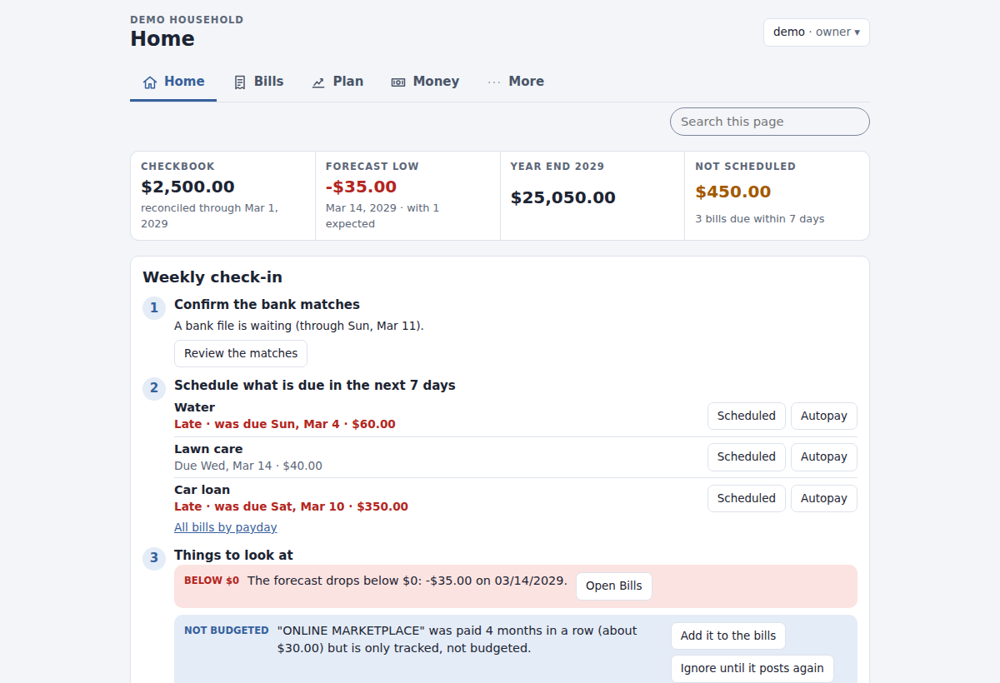
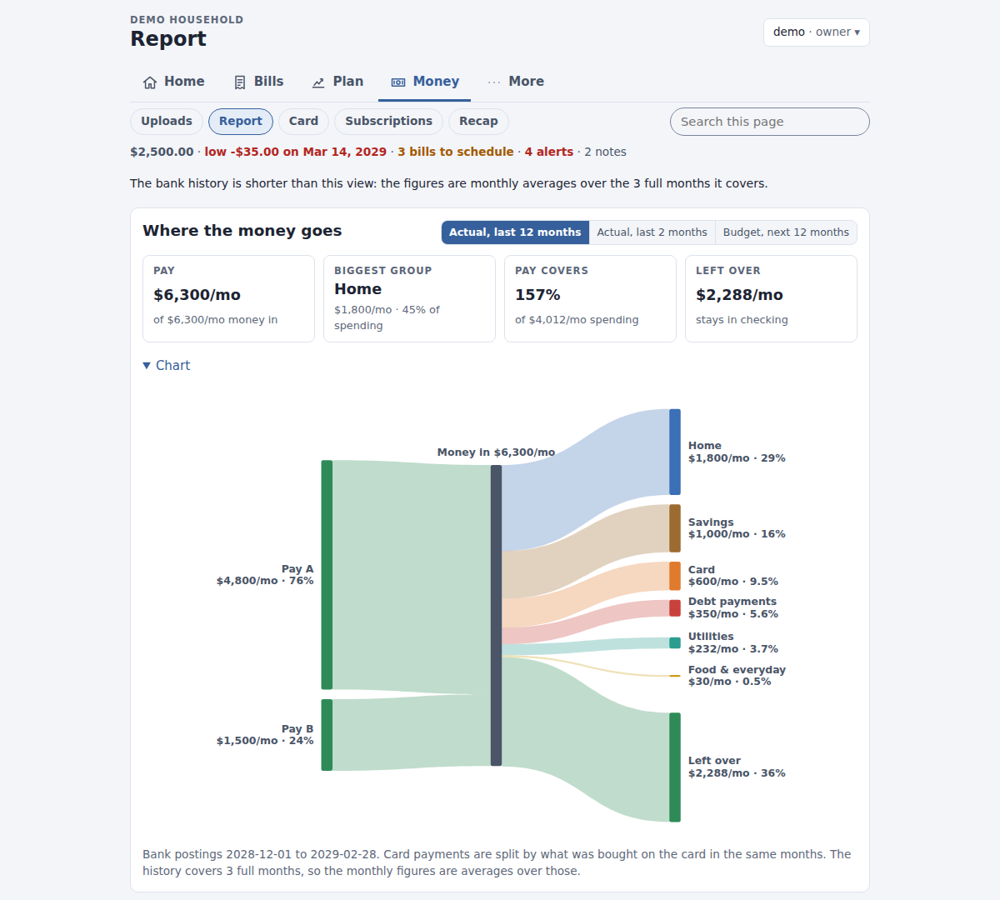
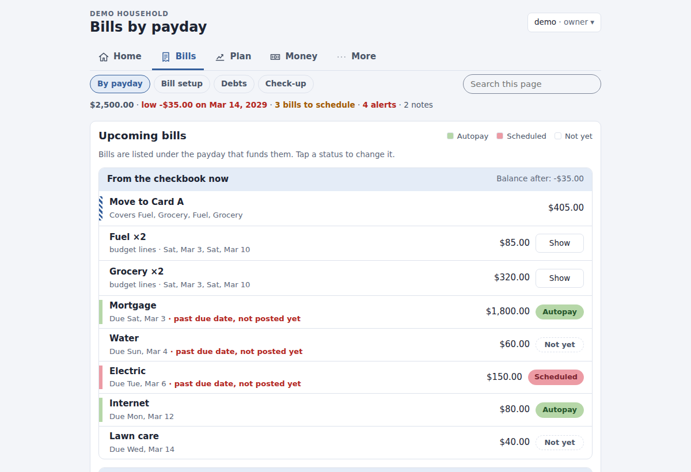
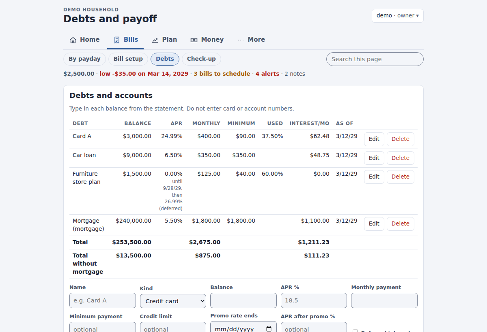

# Hearthfund

A self-hosted checkbook forecast for a household. You list your paydays and bills; the app lays them out as dated
rows, shows the running balance and the lowest point ahead, and checks your bank export against the plan each week.

- **Bills**: *By payday* (each payday and the bills it pays, with autopay / scheduled / not-yet status), *Bill
  setup* (every paycheck, bill and spending budget that repeats, in three lists), *Debts* (what you owe: balances,
  a payoff planner with highest rate or smallest balance first, extra payments, 0% promos and a burn-down chart)
  and *Check-up*.
- **Plan**: "can we afford it?" what-ifs and expected one-off items.
- **Money**: *Uploads* (upload a bank export as CSV, OFX or QFX, review the matches, apply), *Report* (where the
  money goes), *Card* (card spending by category), *Subscriptions* and a monthly *Recap*. *Check-up*, under
  Bills, compares the bills with what the bank paid.

| Home: the weekly check-in | Where the money goes |
|---|---|
| [](docs/img/home.png) | [](docs/img/report.png) |
| **Bills by payday** | **Debts and payoff** |
| [](docs/img/bills.png) | [](docs/img/debts.png) |

It works on a phone too ([picture](docs/img/home-phone.png)). The pictures show the built-in demo household; every
name and amount in them is made up.

**Privacy:** it runs on your own machine in one Docker container. Your data stays in a `./data` folder; the app makes
no outbound connections, has no telemetry and loads nothing from the internet.

**Good to know before you start**

- **US dollars and US formats only** for now (`$1,234.56`, month/day/year). Other currencies are on the
  [roadmap](docs/ROADMAP.md).
- **Bank data comes from files you upload**: your bank's CSV, OFX or QFX export. An optional
  [Plaid connection](docs/PLAID.md) exists for banks with no usable export, but it needs your own Plaid developer
  account and Plaid's approval for real banks, which takes time and may cost money.
- **It is meant for your home network or Tailscale**, not the open internet:
  [remote access](docs/DEPLOY.md#remote-access).
- What stays compatible across upgrades: [docs/STABILITY.md](docs/STABILITY.md). Security reports:
  [SECURITY.md](SECURITY.md).

## Quick start

You need Docker with the Compose plugin 2.24 or later.

```sh
git clone https://github.com/optimus506/hearthfund.git
cd hearthfund
docker compose up -d                          # pulls the released image
docker compose exec app cat /data/setup-token
```

No git? One downloaded file is enough: see [Install without cloning](docs/DEPLOY.md#install-without-cloning).

To build the image from the source instead, use `docker compose -f docker-compose.yml -f compose.build.yml up -d --build`,
and put `COMPOSE_FILE=docker-compose.yml:compose.build.yml` in `.env` so later `docker compose` commands keep using
your build.

Open <http://127.0.0.1:8080>, enter the setup token, and choose an admin name, a password (10 characters or more)
and a household name. More on settings, data and upgrades: [docs/DEPLOY.md](docs/DEPLOY.md).

**Setup rules.** The setup page works only while there are no users. The token is a one-time code in
`data/setup-token`; it is never logged or shown in a URL, and the file is deleted when setup is done. For a scripted
setup, either run `docker compose exec app hbudget create-admin NAME` (it asks for the password; `--password-stdin`
reads it from standard input), or set `HBUDGET_ADMIN_USERNAME` and `HBUDGET_ADMIN_PASSWORD` in `.env` before the
first start (they are read only while there are no users; remove them afterwards).

## First steps

On the setup page, **Start with** offers:

- **The demo household**: made-up bills, three months of bank and card history and a bank export waiting on the
  Uploads page, so you can try everything. `HBUDGET_DEMO=1` in `.env` makes it the default (and fills the first
  household when the admin comes from `HBUDGET_ADMIN_*`). Later demos: Admin > Households, or `hbudget demo`.
- **An empty budget**: set your checkbook balance and its date on **More > Settings**, then add income and bills on
  **Bills > Bill setup**, or import them (below).

**Signs.** In the ledger, money out is positive and money in is negative (a bill of 150 is `150`, a paycheck of 2,400
is `-2400`); the pages show money in with a `+`. In bank files the bank's own sign is kept (`-150.00` is money out).

## Importing your bills

On **More > Import** (owners only):

- **A bill-system file** (YAML or JSON). Start from [examples/bill-system.example.yaml](examples/bill-system.example.yaml)
  (its dates are in 2029, so it imports the same way whenever you try it; look ahead on the pages to see its rows):
  every field is explained in its comments, and [schema/bill-system.schema.json](schema/bill-system.schema.json) is
  the full format. *Merge* adds or updates bills by id; *Replace* replaces the bills and their rows. The household
  keeps its name, and its bank history stays. The file's checkbook balance is used for a new household; otherwise
  tick **Also set the checkbook balance from the file**. Run it as a dry run first.
- **A simple CSV of bills**: `name,kind,amount,cadence,start,day,days,month,weekend,status,funded_by,card,group`,
  one bill per line; see [examples/bills.example.csv](examples/bills.example.csv). A bills CSV has no checkbook
  balance, so set it on More > Settings (see [First steps](#first-steps)).
- Column-by-column details for all of these, and the bank CSV layouts: [docs/IMPORT.md](docs/IMPORT.md).
- **A spreadsheet** (.ods, .xlsx or .csv) laid out as one row per bill or payday. After reading the file you choose
  the name, amount and date columns, the starting-balance cell and rows to skip; the status (autopay / scheduled) can
  come from the name cell's colour. Save the mapping as a profile to reuse it. Only the budget is replaced; bank
  history and uploads stay.

## Reconciling with the bank

1. **Money > Uploads**: upload a bank export: CSV, OFX or QFX. A CSV with a new column layout asks once which column is the
   date, description, amount (or debit/credit) and balance; save it as a layout for next time. Account numbers in
   descriptions and file names are masked, and the file itself is not kept.
2. **Preview** (a dry run). The app finds the posting whose running balance equals your checkbook balance and takes
   everything newer, so the export must reach back to that point. (Files without a balance column are taken from the
   last reconciled date on, skipping postings already seen.)
   - **Cleared automatically:** postings that match a payee rule and the bill's amount (within 10% or $25).
   - **Needs your decision:** proposals. *Clear* marks the proposed row(s) as paid. *Reduce* treats the posting as a
     partial payment: the row is lowered by that amount and the rest stays open (offered when one row is larger than
     the payment). Leave a proposal alone to decide later. Alternatives for the same bank item exclude each other.
   - **Card payments:** a payment to a credit card is not new spending. It is proposed as a bundle of the card-paid
     rows (groceries, fuel, ...) it covers.
   - **No budget row:** tracked items (counted in reports) and unmatched ones (consider a payee rule).
3. **Apply.** The checkbook balance becomes the bank's latest balance and the report is kept under Past
   reconciliations.

Payee rules (**More > Rules**) link bank descriptions to bills; the first rule that matches wins. You do not have to
write them all yourself: **Starter rules** on that page (or `hbudget rule-pack`) adds ready-made rules for common payees (paychecks, the usual
bills, groceries, fuel, streaming and more), linked to your bills by name, after showing what it would add. The
pack is [examples/starter-rules.yaml](examples/starter-rules.yaml); download it there to change it and add your
own copy.

From the command line, `hbudget reconcile FILE` is a dry run, and `--accept P1:clear,P2:reduce --write` applies it and records the file
as an upload, like the web page does.

## Who can do what

| Role | Can |
|---|---|
| Owner | everything, including import, wipe and members |
| Editor | change bills, rows, rules, debts and settings; upload and reconcile; back up |
| Contributor | mark bills autopay / scheduled, and mark expected items posted |
| Viewer | read everything |

Owners add members on **More > Members**; the admin manages users and households on **Admin**.

## Backup, restore, upgrade

- **Back up:** **More > Export** > Backup (YAML or JSON) holds everything in the household: bills, rows, rules, debts, bank and
  card history, uploads, reconciliations, notes and settings.
- **Nightly copies:** `docker compose exec -T app hbudget backup --keep 14` copies the database while the app runs,
  checks it and keeps the newest 14; run it from a timer ([docs/DEPLOY.md](docs/DEPLOY.md#your-data-and-backups)).
- **Keep backups private.** A backup (the Export download, `hbudget export > file`, or a copy of `./data`) is the
  household's full financial history, **unencrypted**. Create it readable by you only, store it encrypted or on a
  disk only you use, and do not email it or put it in a shared cloud folder:

  ```sh
  (umask 077; docker compose exec -T app hbudget export --format yaml > backup.yaml)   # mode 600
  chmod 600 ~/Downloads/hearthfund-*.yaml                                        # a download from the page
  ```
- **Restore:** **More > Import** > bill system, choose the backup with *Replace*. A dry run shows what would be deleted; the real
  restore replaces everything in that household, including its history, takes the backup's household name, and asks
  you to type the current household name first.
- **Upgrade:** `git pull && scripts/upgrade.sh` (backup, pull, restart, roll back if the new version does not start).
  Built from source: `git pull && docker compose up -d --build` instead.
  The database is upgraded on start, with a copy made first in `data/backups/`. Details in [docs/DEPLOY.md](docs/DEPLOY.md#upgrading).

## API and AI agents

Other programs and AI agents such as Claude Code can read the budget through an access token, and with a write
token mark bills, edit rows and reconcile bank exports: see [docs/API.md](docs/API.md).

## Using it from other devices

The app listens on 127.0.0.1 only by default. Use Tailscale or a reverse proxy with HTTPS, or, on a trusted home
network only, set `HBUDGET_BIND_ADDRESS=0.0.0.0` together with `HBUDGET_ALLOWED_HOSTS` and `HBUDGET_PUBLIC_URL`
(three lines, see the link). The app can serve HTTPS itself with your own certificate
(`HBUDGET_TLS_CERT` / `HBUDGET_TLS_KEY`). Never forward the port on your router:
[docs/DEPLOY.md](docs/DEPLOY.md#remote-access).

**Two-factor sign-in.** Under **Account** each person can turn on a second step: after the password, a 6-digit
code from an authenticator app on their phone. It is optional and off by default; turn it on whenever the app
can be reached from outside your home. Lost the phone and the recovery codes? An admin resets it on the Admin
page, or on the server: `docker compose exec app hbudget disable-2fa USERNAME`. `HBUDGET_REQUIRE_2FA=1` in `.env`
makes everyone set it up.

## Command line

```sh
docker compose exec app hbudget --help
docker compose exec app hbudget households
docker compose exec -T app hbudget import-bills --dry-run - < examples/bill-system.example.yaml   # what it would do
docker compose exec -T app hbudget import-bills - < examples/bill-system.example.yaml             # import it
docker compose exec app hbudget rule-pack                                                         # starter rules: dry run
docker compose exec app hbudget rule-pack --write                                                 # add them
docker compose exec -T app hbudget reconcile - < examples/sample-bank.csv                          # dry run: P1, P2
(umask 077; docker compose exec -T app hbudget export --format yaml > backup.yaml)   # private: full history
```

`-` (or `/dev/stdin`) reads the file from standard input; `--household` takes an id or a name and can be left out when
there is only one household. More examples: [docs/DEPLOY.md](docs/DEPLOY.md#using-the-command-line-tools-with-docker).

## Troubleshooting

- **"Missing or expired security token"**: reload the page. When you open the app by a name other than
  `127.0.0.1`, add it to `HBUDGET_ALLOWED_HOSTS` and set `HBUDGET_PUBLIC_URL`.
- **"Invalid host header" (400)**: the name in the address bar is not in `HBUDGET_ALLOWED_HOSTS`.
- **Too many attempts (429)**: wait the number of seconds shown; repeated wrong passwords slow down sign-in.
- **"The starting balance ... does not appear in this export"**: the export does not reach back to your last
  balance, or the balance on More > Settings is not one the bank shows. The upload stays waiting; fix either and
  preview again.
- **"The balance chain breaks"**: the export is missing postings; download it again with a wider date range.
- **Logs**: `docker compose logs app`. Descriptions and amounts are never logged.

## More

- [docs/DEPLOY.md](docs/DEPLOY.md): settings, data, ownership, remote access, arm64.
- [docs/ARCHITECTURE.md](docs/ARCHITECTURE.md): how it works inside.
- [CONTRIBUTING.md](CONTRIBUTING.md): development, tests and reviews.
- License: [MIT](LICENSE).
